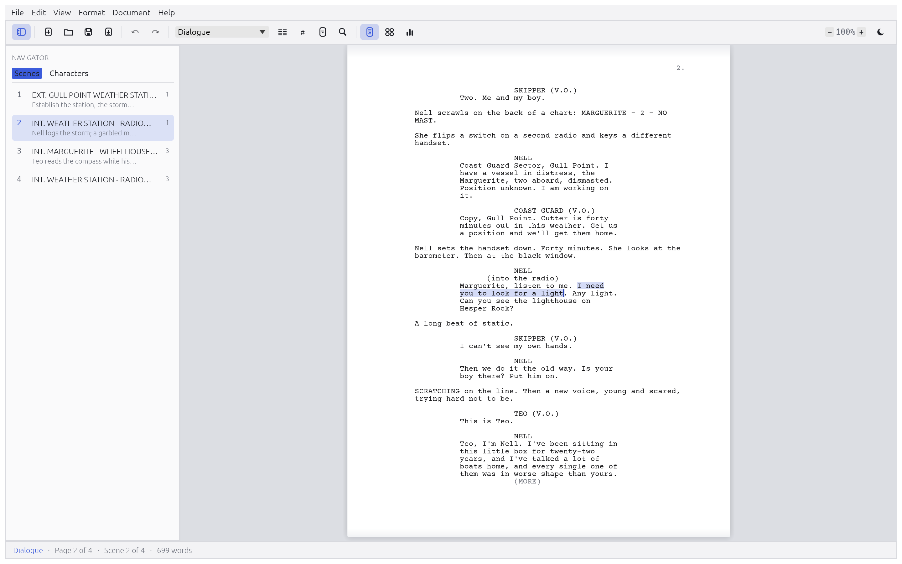
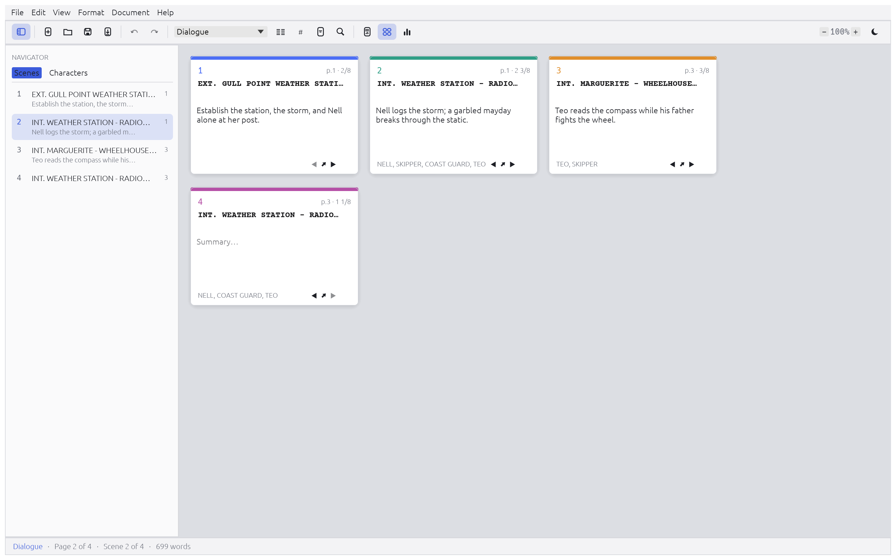
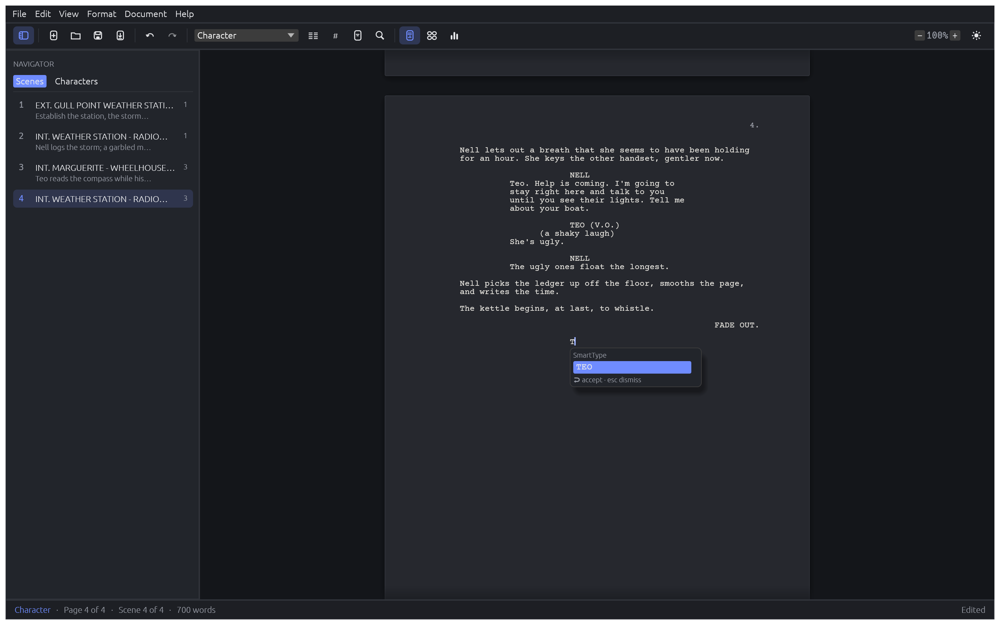
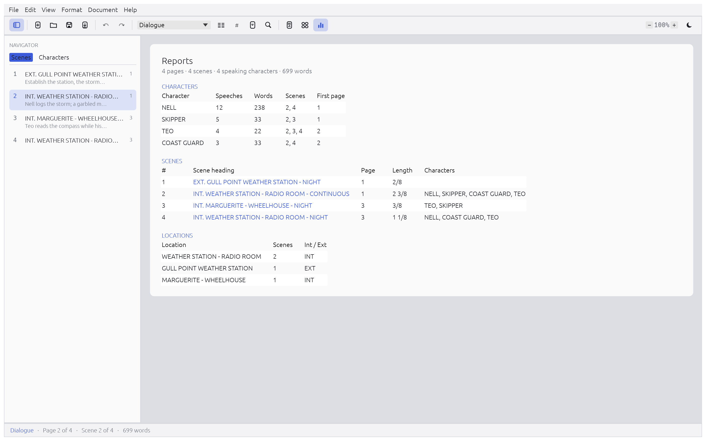

<h1 align="center">ScriptCraft</h1>

<p align="center">
  <b>Screenwriting; an open-source, clean-room take on the Final Draft workflow, built in pure Rust.</b>
</p>

<p align="center">
  A fast, open-source screenwriting app that works the way screenwriters already work: elements that
  flow with Enter and Tab, SmartType, industry-standard pagination with (MORE) and (CONT'D), a scene
  navigator, index cards and reports. It reads and writes Final Draft (.fdx) and Fountain files,
  exports PDF, and every action can be driven by agents.<br>
  <i>A Craft app in the style of the <a href="https://getartcraft.com/apps">ArtCraft Crafting Apps</a>.</i>
</p>

<p align="center">
  <a href="https://github.com/NoJuanNobody/scriptcraft/actions/workflows/ci.yml"></a>
  
  
  
  
  
</p>

<br>

<p align="center">
  
  <br><sub><b>Night Signal</b>, ScriptCraft's built-in original sample: page view, element picker, navigator with scene summaries.</sub>
</p>

<p align="center">
  <a href="#downloads">Downloads</a> ·
  <a href="#a-tour">A tour</a> ·
  <a href="#what-works-today">What works today</a> ·
  <a href="#quick-start">Quick start</a> ·
  <a href="#for-agents-cli-mcp-and-the-control-channel">For agents</a> ·
  <a href="#architecture">Architecture</a> ·
  <a href="#roadmap">Roadmap</a> ·
  <a href="#license-and-credits">License and credits</a>
</p>

## Downloads

**Windows:** Download the latest release from [GitHub Releases](https://github.com/NoJuanNobody/scriptcraft/releases). Extract the ZIP, run `scriptcraft.exe`, and start writing. See [docs/windows-setup.md](docs/windows-setup.md) for detailed instructions and troubleshooting.

**macOS & Linux:** Build from source (see [Quick start](#quick-start) below).

**Web:** Try the browser version at [scriptcraft-web.pages.dev](https://scriptcraft-web.pages.dev) (experimental).

## A tour

Every screenshot is ScriptCraft itself, rendered offscreen by its own UI harness
(`cargo run -p scriptcraft-ui-egui --example ui_shot`).

<table>
<tr>
<td width="50%" valign="top"><p align="center"><sub><b>Index cards.</b> One card per scene with an editable summary, page, length in eighths and cast; reorder scenes from the cards.</sub></p></td>
<td width="50%" valign="top"><p align="center"><sub><b>Dark mode and SmartType.</b> Character names, extensions, scene intros, locations, times and transitions complete as you type. Dual dialogue sits side by side.</sub></p></td>
</tr>
<tr>
<td colspan="2"><p align="center"><sub><b>Reports.</b> Character, scene and location reports, computed from the same pagination as the PDF.</sub></p></td>
</tr>
</table>

## Why ScriptCraft

- **Familiar.** Final Draft's element flow: Enter after a scene heading gives Action, Tab after
  Action gives a Character, Enter after a Character gives Dialogue, Tab in Dialogue gives a
  Parenthetical (with the parentheses typed for you). Headings, cues and transitions capitalise
  themselves. ⌘1–⌘8 pick an element, and Enter in an empty paragraph shows the element list.
- **Industry pages.** US Letter, 12-point Courier at ten characters and six lines per inch, standard
  indents, page numbers top-right, (MORE)/(CONT'D) when dialogue breaks across pages, no orphaned
  scene headings — the same layout on screen, in reports and in the PDF.
- **Your files.** Opens and saves Final Draft XML (.fdx) and Fountain (.fountain) with bold,
  italic and underline intact; exports PDF with embedded, selectable Courier Prime. Autosave,
  crash recovery and backups keep your work safe.
- **Built for agents.** Every action is a command with an id. The same 91 engine commands (plus 31
  window commands) drive the menus, toolbar, keyboard shortcuts, a command-line tool, a JSON
  control channel and an MCP server.
- **Never crashes on your script.** No `unwrap`/`panic` outside tests, hostile input is clamped, and
  a test runs every command with junk parameters.
- **Open.** MIT OR Apache-2.0, clean-room, every asset original or openly licensed.

## What works today

| Area | Highlights |
|---|---|
| **Writing** | Eight elements (Scene Heading, Action, Character, Parenthetical, Dialogue, Transition, Shot, General); Enter/Tab/Shift+Tab element flow ([docs/typing-parity.md](docs/typing-parity.md)) and an element list on Enter in an empty paragraph; per-script Element Settings (indents, spacing, alignment, capitals, Enter/Tab targets); bold, italic, underline; offline spelling with suggestions and a user dictionary; automatic capitals and parentheses; `int. ` in Action becomes a heading; SmartType; dual dialogue; undo/redo (typing coalesced); copy and paste that keep elements; find and replace |
| **Pages** | Letter, Courier 12, 54 lines; Action 1.5"–7.5", Character 3.7", Dialogue 2.5"–6.0", Parenthetical 3.1"–5.6", Transition right-aligned at 7.5"; page numbers from page 2; (MORE)/(CONT'D) across dialogue breaks (split at sentence ends, never after a parenthetical); headings and cues kept with what follows; action split only with two lines each side; automatic character (CONT'D); scene numbers in both margins; title page |
| **Structure** | Navigator (scenes with summaries, colours and pages; acts, sequences and sections; characters; bookmarks), index cards with editable summaries, colours and tags, drag to reorder scenes, go to scene/page; Outline view to rearrange scenes under acts and sequences; story map scaled to pages; beat board with beats linked to scenes |
| **Reports** | Characters (speeches, words, scenes, first page), scenes (page, length in eighths, cast), locations (INT/EXT) |
| **Files** | `.fdx` open/save (incl. text styles, element settings, dual dialogue, scene numbers, card summaries/colours, title page), `.fountain` open/save (the public fountain.io syntax incl. emphasis), PDF export; autosave with crash recovery, backups on save, recent files, drag-and-drop to open |
| **Window** | Menu bar, toolbar with element picker and B/I/U, page view with page breaks or a continuous speed view, split screen with two views, blinking caret, status bar (element · page x of y · scene · words), light and dark themes, zoom (menus, Ctrl/⌘+wheel, pinch, fit width); unsaved-changes prompts on close, quit and open; runs natively and in the browser |
| **Drafts and production** | Revision mode with coloured pages, locked pages with A/B pages, omitted scenes, headers and footers, A4, script notes, alternate lines, production tagging and breakdown reports, print; track changes per author with accept/reject; Compare Drafts; templates for feature, TV single-camera, multi-camera and stage play |
| **Together and aloud** | Real-time collaboration on a local network with names and carets ([docs/collaboration.md](docs/collaboration.md)); read aloud with a system voice per character; dictation that turns spoken phrases into formatted script |
| **Agents** | `scriptcraft-cli` (convert, run, report, commands, parity), MCP server (headless or bridged to the window), keyed loopback control channel, headless screenshots |

The full Final Draft 13 comparison, including what's not done yet, is in
[docs/parity-checklist.md](docs/parity-checklist.md): **62 implemented · 0 partial · 6 not yet**.

## Quick start

Requires Rust 1.95+ (edition 2024).

```sh
git clone https://github.com/NoJuanNobody/scriptcraft && cd scriptcraft
cargo run --release -p scriptcraft                       # opens the sample script
cargo run --release -p scriptcraft -- --new              # blank script
cargo run --release -p scriptcraft -- my-script.fdx      # open a Final Draft or Fountain file
```

### Settings and data

ScriptCraft stores settings like the other Craft apps, through
[`craft-settings`](https://github.com/storytold/craft-libs/tree/main/crates/settings): one
commented `config.toml` (`[appearance]`, `[editing]`, `[files]`), saved half a second after a
change, with a `.bak`, recovery of damaged files and hand edits preserved. The folder is the
first match of `--config-dir <dir>`, `SCRIPTCRAFT_CONFIG_DIR` (set but empty = isolated: nothing
read or written), a `portable` marker next to the app (settings in `config/` beside it), then the
platform folder (`~/Library/Application Support/scriptcraft`, `%APPDATA%\scriptcraft`,
`~/.config/scriptcraft`). Autosave recovery, backups and the user dictionary are not settings:
they live in the data folder, so a settings reset never loses work. The first run imports an older
`prefs.json` and leaves it in place. Help › About shows the folders in use.

In the browser: `cargo xtask web` (needs `rustup target add wasm32-unknown-unknown` and
`cargo install wasm-bindgen-cli` at the version in Cargo.lock), then serve
`apps/scriptcraft-web/dist/` with any static server, e.g. `python3 -m http.server -d apps/scriptcraft-web/dist`.

Writing a scene: type `int. diner - night`, **Enter** (Action), type the action, **Tab**
(Character), type `margo`, **Enter** (Dialogue), type the line, **Tab** for a parenthetical or
**Enter** to go back to Action. ⌘1–⌘8 (Ctrl on Windows/Linux) set an element directly.

## For agents: CLI, MCP and the control channel

```sh
scriptcraft-cli convert draft.fountain draft.pdf        # also .fdx ↔ .fountain
scriptcraft-cli report draft.fdx                        # characters, scenes, locations
scriptcraft-cli commands                                # every command id, shortcut, params
scriptcraft-cli run --cmd 'text.insert={"text":"INT. DINER - NIGHT"}' --cmd text.enter \
    --cmd 'text.insert={"text":"Rain on the glass."}' --cmd text.tab \
    --cmd 'text.insert={"text":"MARGO"}' --cmd text.enter \
    --cmd 'text.insert={"text":"Coffee?"}' --save scene.pdf
scriptcraft-cli mcp                                     # MCP server on stdio (headless)
scriptcraft-cli mcp --connect 127.0.0.1:7990            # drive the running app (scriptcraft --control 7990)
```

- [docs/mcp.md](docs/mcp.md): MCP tools (`list_commands`, `execute`, `batch`, `inspect_script`,
  `get_fountain`, `set_fountain`, `reports`, `screenshot`).
- [docs/control-protocol.md](docs/control-protocol.md): the JSON-lines control channel, its key
  file, and `ui_shot` for headless screenshots.

## Architecture

A Cargo workspace; lower layers never depend on higher ones (`cargo xtask layers`), and nothing
below the UI depends on egui.

| Layer | Crate | Job |
|---|---|---|
| L0 | `scriptcraft-geom` | Letter page and Courier metrics (10 cpi, 6 lpi, 54 lines) |
| L1 | `scriptcraft-doc` | screenplay model: element-typed paragraphs, title page, settings, clamped edit primitives |
| L1 | `scriptcraft-fonts`, `scriptcraft-spell`, `scriptcraft-control-key` | Courier Prime (OFL); offline English spelling (SCOWL); the control key file |
| L2 | `scriptcraft-fountain`, `scriptcraft-fdx` | Fountain and Final Draft XML import/export |
| L2 | `scriptcraft-layout` | pagination, (MORE)/(CONT'D), dual dialogue, caret and hit testing |
| L3 | `scriptcraft-pdf` | PDF export with krilla |
| L4 | `scriptcraft-engine` | Session, undo, **command registry**, typing flow, SmartType, reports, file I/O, Final Draft 13 catalog |
| L5 | `scriptcraft-mcp` | MCP server, headless or bridged to the app |
| L6 | `scriptcraft-ui-egui` | the egui window (swappable) and `ui_shot` |
| apps | `scriptcraft`, `scriptcraft-cli`, `scriptcraft-web` | desktop app (eframe + wgpu), command line, browser app (WebGL) |

**Everything is a command:** a `CommandSpec` (id, label, menu location, shortcut, params doc,
`enabled`, `run`) in `crates/engine/src/cmd/*.rs`, dispatched identically by menus, shortcuts, CLI,
control channel and MCP. Quality gate: `cargo xtask ci` (fmt, clippy `-D warnings`, tests, assets,
layers, parity doc up to date).

## Roadmap

See [ROADMAP.md](ROADMAP.md); every gap is tracked as a
[GitHub issue](https://github.com/NoJuanNobody/scriptcraft/issues) under milestones. v0.2–v0.4 are done; next up: file-format fidelity
(Shot/General in Fountain, full FDX title pages, importing from Word, Celtx and PDF) and checking
the typing flow against real Final Draft 13.

## Contributing

Issues and pull requests are welcome. Read [AGENTS.md](AGENTS.md) for the rules (never crash,
clean room, everything is a command) and run `cargo xtask ci` before opening a PR.

## License and credits

MIT OR Apache-2.0 ([LICENSE-MIT](LICENSE-MIT), [LICENSE-APACHE](LICENSE-APACHE)). Typeface:
[Courier Prime](https://github.com/quoteunquoteapps/CourierPrime) (SIL Open Font License 1.1).
Architecture patterns adapted from WordCraft (MIT OR Apache-2.0); see [NOTICE](NOTICE) and
[ATTRIBUTION.md](ATTRIBUTION.md).

ScriptCraft is a clean-room project: built from public file-format structure and widely documented
screenwriting conventions. It contains no Final Draft code, icons, images, templates, sample
scripts or fonts. Final Draft is a trademark of its owner; ScriptCraft is not affiliated with it.
